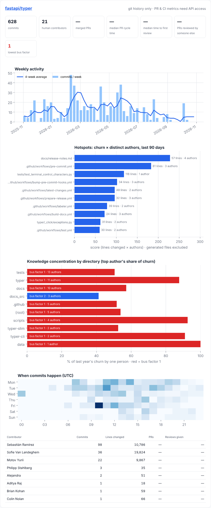
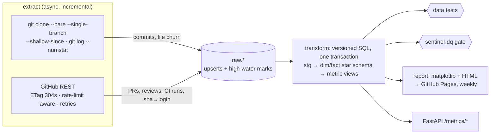

# gitpulse

**Engineering analytics from git history and GitHub.** gitpulse extracts commits, file churn, pull requests, reviews and CI runs into a PostgreSQL star schema. It then computes delivery and code-health metrics in SQL (PR cycle time, review coverage, hotspots, bus factor, change-failure rate) and publishes a weekly report to GitHub Pages. Its warehouse is validated by **[sentinel-dq](https://github.com/AtishayKashyap/sentinel-dq)**, a data-quality engine I also built.

[](https://github.com/AtishayKashyap/gitpulse/actions/workflows/ci.yml)


**[▶ Live report](https://atishaykashyap.github.io/gitpulse/)**: rebuilt every Monday by GitHub Actions from live GitHub data (this project, Sentinel-DQ, VetLedger, Typer and Flask).



## What it answers

| Question | Metric | How it's computed |
|---|---|---|
| Are we shipping steadily? | Weekly commits and merged PRs, with a 4-week moving average | Calendar spine (`dim_date`) so quiet weeks show as 0 instead of disappearing; `AVG() OVER (ROWS 3 PRECEDING)` |
| How long do PRs wait? | Cycle time p50/p90, time to first review | `percentile_cont` (medians, so one stale PR can't skew the number); self-reviews don't count |
| Is code actually reviewed? | Review coverage | Merged human PRs reviewed by someone other than the author |
| Where will bugs come from? | Hotspots | Last 90 days of churn × distinct authors per file, excluding lockfiles, generated files and bots |
| Who can't go on holiday? | Bus factor per directory | The smallest set of people covering ≥50% of a year's churn, using a running `SUM() OVER` sorted by contribution |
| Is delivery healthy? | Deploys per week, change-failure rate, CI duration | DORA-style proxies from workflow runs on the default branch |

## Architecture



**Why `git log` and not only the API?** Line stats would cost one API call per commit. A single shallow clone gives per-file churn for every commit locally, so a full 3-year extract of four large repos takes 15 seconds. The API is used for what only it has: PRs, reviews, CI runs, and the commit→login mapping that drives identity resolution.

## Quick start

```bash
make install                          # Python 3.11+
createdb gitpulse
export GITHUB_TOKEN=...               # optional; 5,000 instead of 60 requests/hour
.venv/bin/gitpulse run                # extract → transform → report into ./site
open site/index.html
.venv/bin/gitpulse serve              # API on :8000 (/docs for OpenAPI)
make dq                               # validate the warehouse with sentinel-dq
```

Configure the repositories in `gitpulse.yml`:

```yaml
since_days: 365
repos:
  - pallets/flask
  - name: my-org/service
    deploy_workflows: [Deploy]        # successful runs on the default branch = deployments
identities:                           # like .mailmap: merge aliases into one person
  old.address@personal.com: octocat
```

## Engineering details

**Extraction**
- **Incremental and resumable.** Each (repo, stream) has a high-water mark that advances in the *same transaction* as the rows. A crash re-fetches one window at most, and upserts make the overlap harmless.
- **Conditional requests.** ETags are persisted in Postgres, so they survive between CI runs, and unchanged pages come back `304`. Those don't count against the rate limit: on a second run, 8 of 10 requests were 304s.
- **Rate limits** handled: primary (`X-RateLimit-Remaining`/`Reset`), secondary (`Retry-After`), and a pre-emptive pause when the budget hits 0. **Retries** on 5xx and network errors use exponential backoff with full jitter.
- **Early stop.** PRs are listed `sort=updated desc`, and pagination stops at the high-water mark. Reviews are fetched only for changed PRs, with bounded concurrency.
- **Graceful degradation.** If the API is unavailable (private repo without a token, exhausted budget), git-derived metrics are still produced, and the report shows "—" rather than claiming 0 PRs.

**Data cleaning**
- **Identity resolution.** An explicit override wins, then the GitHub login (via the commits API), then a login recovered from `12345+user@users.noreply.github.com`, then the lower-cased email. An email seen *once* with a login inherits it for all of that author's commits. Unrelated identities are **not** guessed together; a test pins this.
- **Excluded from code-health metrics:** bots (`[bot]`, dependabot, renovate), merge commits (they repeat their parents' changes), binary files, and generated or vendored files (lockfiles, `*.min.js`, `dist/`, snapshots). Before this was fixed, `uv.lock` was the #1 "hotspot" in Typer.
- Rename notation from numstat (`src/{old => new}/f.py`) is resolved to the new path, which is property-tested with Hypothesis.

**Modelling**
- Plain versioned SQL files rebuild `mart.*` **inside one transaction**, so readers see the previous build or the new one, never a half-built schema. Models are a pure function of raw data.
- 7 data tests (uniqueness, not-null, referential integrity, invariants such as `merged_at >= created_at`) run after every transform. The **sentinel-dq gate** in CI runs 11 checks, including freshness.

## Performance

Measured locally on 4 vCPUs with Postgres 16, three years of history:

| Step | Result |
|---|---|
| Full extract: fastapi, pydantic, flask, typer (git, repos in parallel) | **8,737 commits, 41,733 file changes in 15.0 s** |
| Incremental re-run | **~2.3 s** (it was up to 38.9 s before switching to single-branch fetches; see ADR 0002) |
| Transform: all models + views | 0.7 s |
| Metric queries (bus factor, hotspots) | ~16 ms |

## Testing

- **31 tests, 94% coverage**, with ruff and mypy `--strict`.
- **GitHub client:** respx-mocked API covering pagination via `Link`, 304 reuse, 5xx and network retries, primary and secondary rate limits, and permission errors.
- **git extraction:** real temporary repositories with two authors (one with a noreply address), a rename, a binary file, a lockfile, a merge, and an incremental fetch.
- **Metrics:** a hand-built dataset where every answer is known in advance. Bus factor is 1 in `src/` and 2 in `lib/`; review coverage is exactly 50% once the self-review and the bot PR are excluded; the median cycle time is 20 h; the change-failure rate is 1/6.
- **End to end:** extract → transform → report → API → CLI, including the degraded git-only path.

## Deploy for free

- **Report:** `.github/workflows/report.yml` runs every Monday and publishes to **GitHub Pages**. One-time setup: Settings → Pages → Source: GitHub Actions.
- **CI:** the pipeline job extracts live data with the built-in `GITHUB_TOKEN`, builds the warehouse in a Postgres service container, gates it with sentinel-dq, and uploads the report.
- **API (optional):** Render free web service (Dockerfile) plus a Neon free Postgres.

## Design decisions
- [ADR 0001: SQL models instead of dbt](docs/adr/0001-sql-models.md)
- [ADR 0002: git for churn, API for collaboration data](docs/adr/0002-git-plus-api.md)
- [ADR 0003: Identity resolution rules](docs/adr/0003-identity-resolution.md)

## License
MIT
